# Pooparazzi

A baby tracker for an Android phone and a Wear OS watch, made for one hand at 3am. Log **sleep**, **feeds** and **diapers** with one or two taps; only the time is ever required.

<p align="center">
  
  &nbsp;
  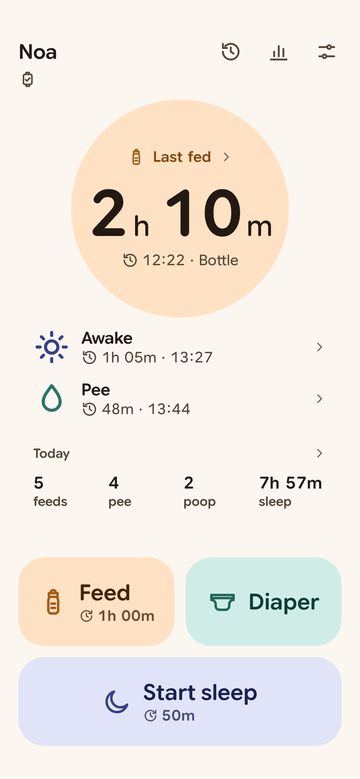
  &nbsp;
  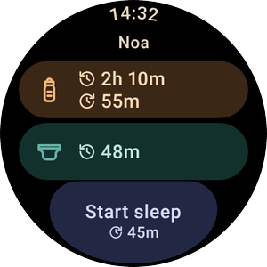
</p>

All screenshots are rendered by the screenshot tests from the sample day in `core/.../sample/SampleData.kt` ([how](#screenshots)).

## Sleep

One button starts a sleep, the same button ends it.

| Asleep | Adjust the start | Undo receipt | Edit a sleep |
|:---:|:---:|:---:|:---:|
| 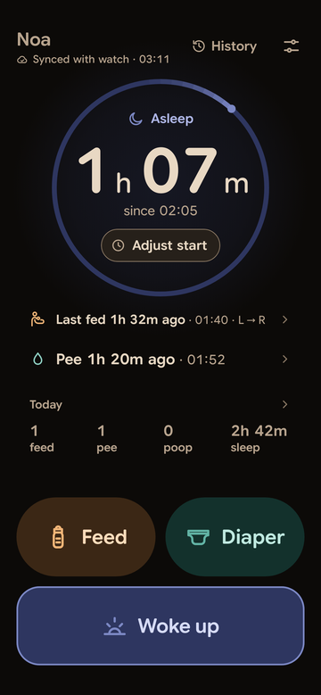 | 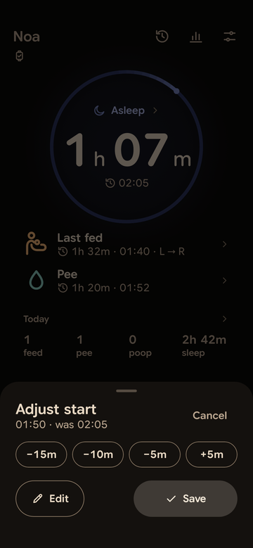 | 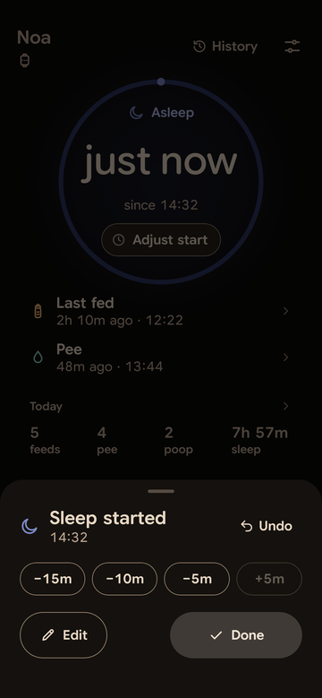 | 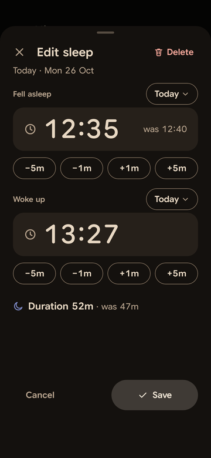 |

## Feeds

Breast (with the order of the sides), Bottle (milk or formula, with an amount), Food, or just the time. −15m / −10m / −5m nudge the time back.

| Feed sheet | Breast: side order | Bottle | Logged |
|:---:|:---:|:---:|:---:|
| 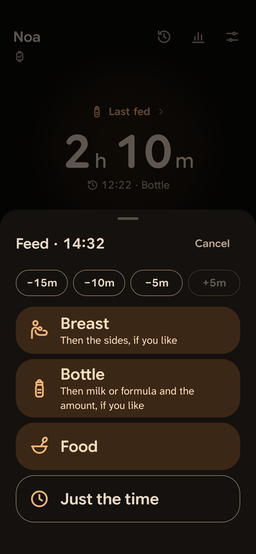 | 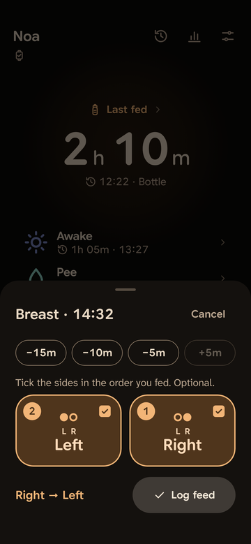 | 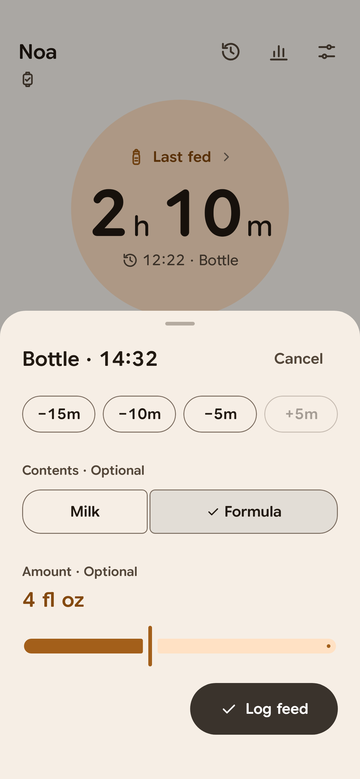 | 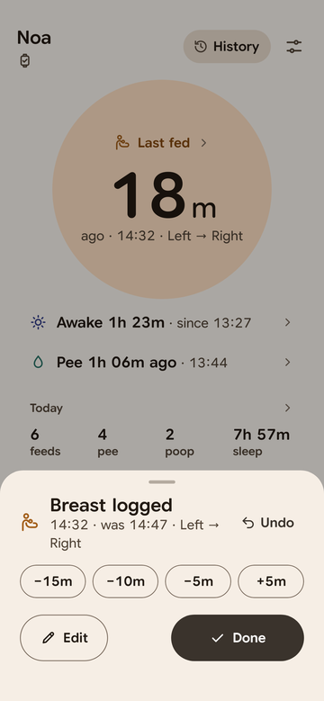 |

## Forgot to log?

When a feed or sleep is logged long after it happened, its sheet offers **Expected** — the time the last 7 days expected it — under the nudge chips. A second tap goes back.

| Forgotten feed | Forgotten sleep |
|:---:|:---:|
| 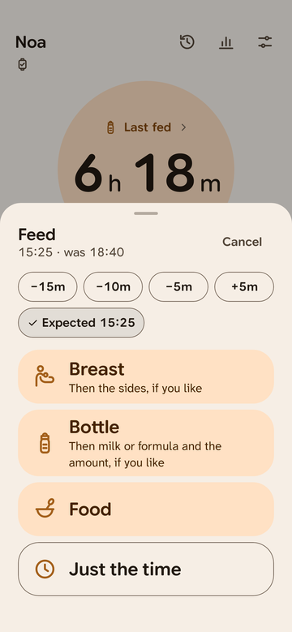 | 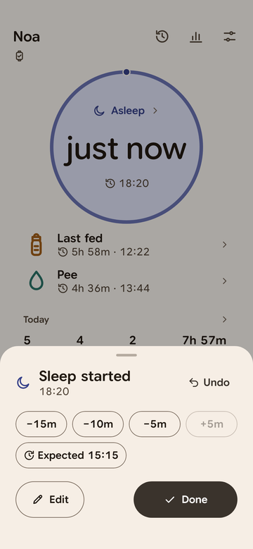 |

## Diapers

Pee and Poop, with an optional colour and texture. Red, black and pale poop shows a gentle hint.

| Diaper sheet | Doctor hint | Backdated | While asleep |
|:---:|:---:|:---:|:---:|
| 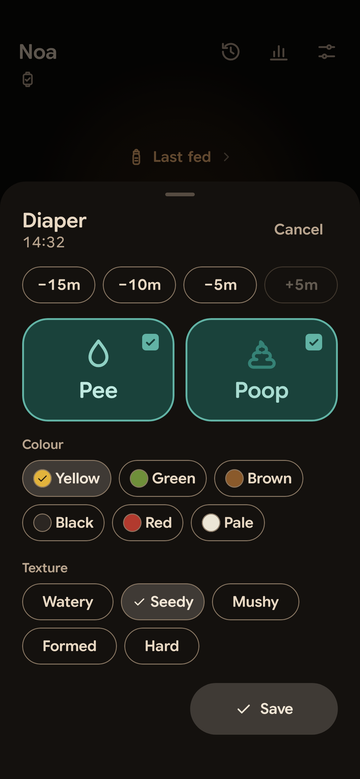 | 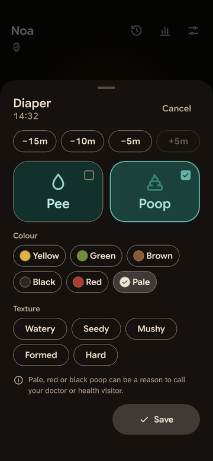 | 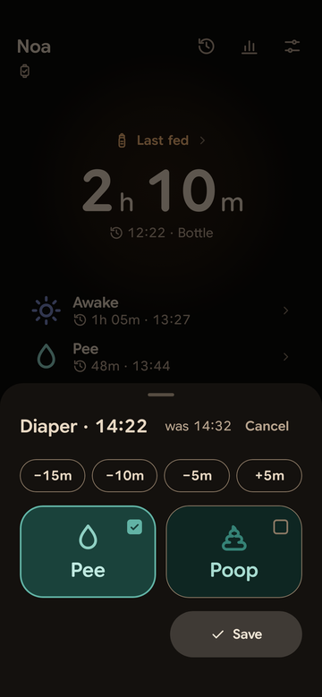 | 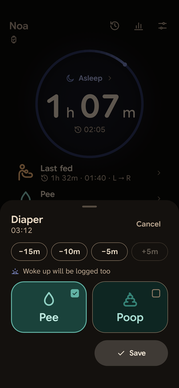 |

## What comes next

Home shows what the last 7 days expect next, also as silent notifications.

| Next feed, sleep, poop | Due now | Notifications | Which ones |
|:---:|:---:|:---:|:---:|
|  | 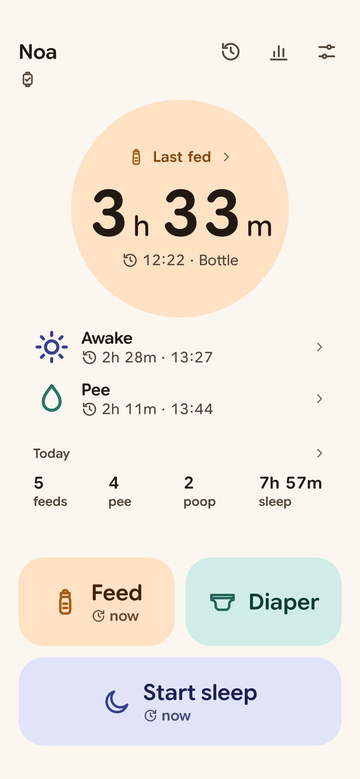 | 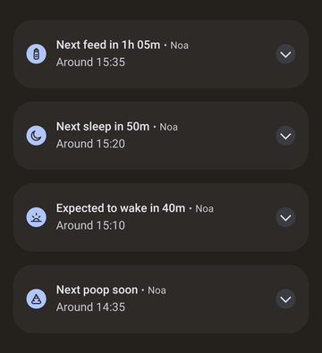 | 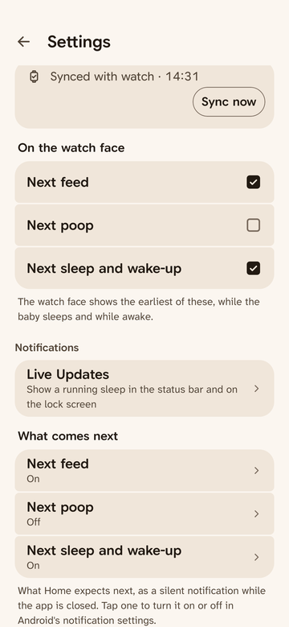 |

## History and edits

| History | History, Night | Edit a feed | Edit a diaper |
|:---:|:---:|:---:|:---:|
| 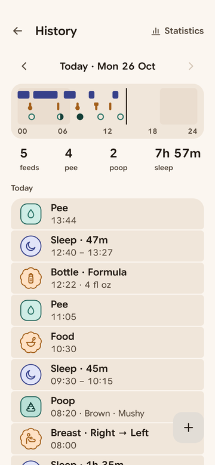 | 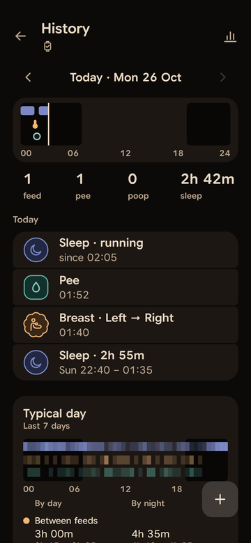 | 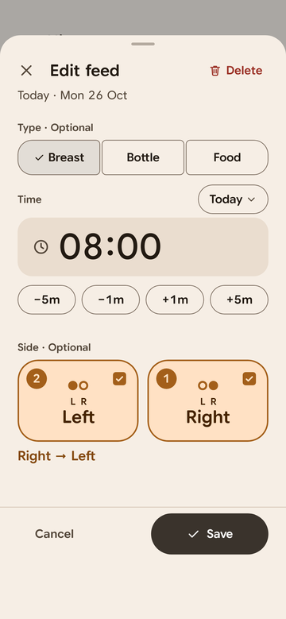 | 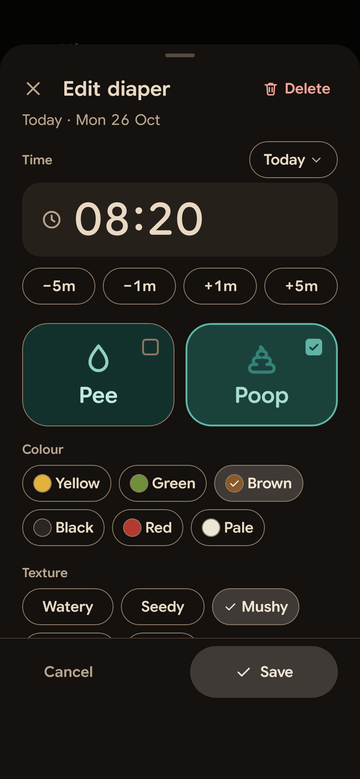 |

| Edit a bottle | Add a past entry | Feed while asleep |
|:---:|:---:|:---:|
| 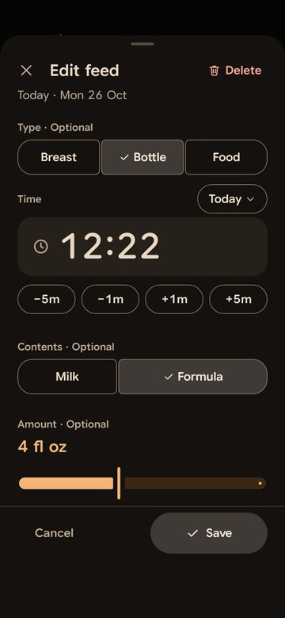 | 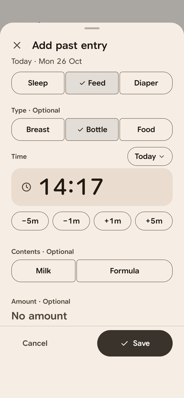 | 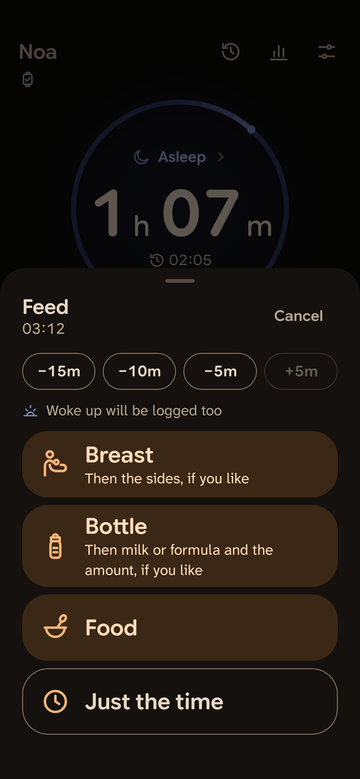 |

## Statistics

Averages per day, a bar chart, and the typical day. Unusual days are greyed out and left out.

| Averages | A bar pressed | An unusual day | Typical day |
|:---:|:---:|:---:|:---:|
| 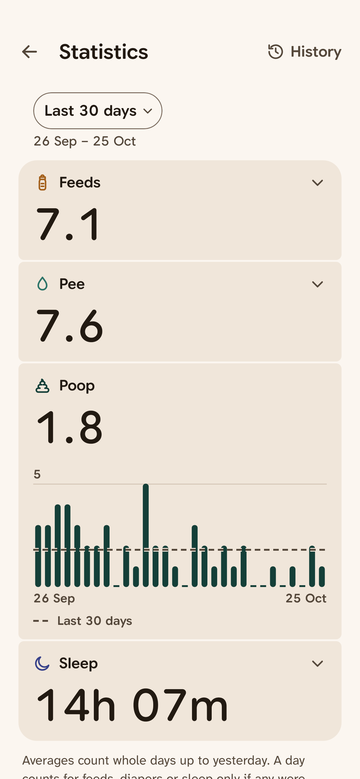 | 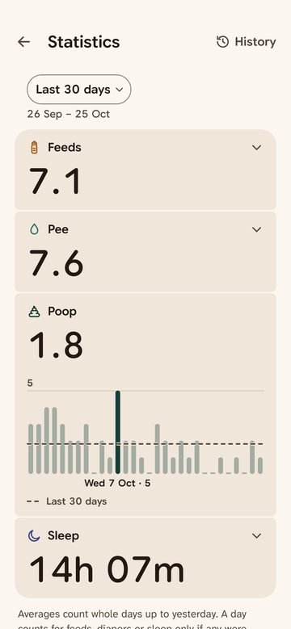 | 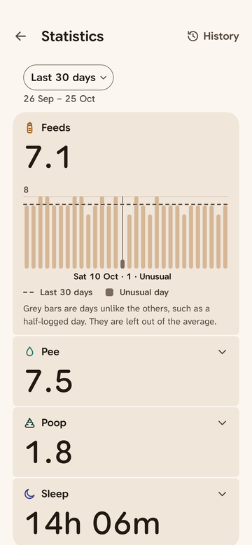 | 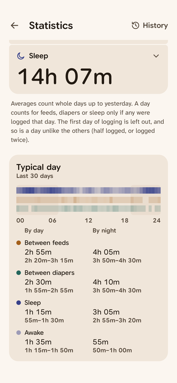 |

## Widgets and notifications

A feed or diaper logged during a sleep ends it, and the phone says so in a notification, wherever it was logged.

| Widget 4×2 | Widget 3×1 | Samsung flip cover | Running sleep |
|:---:|:---:|:---:|:---:|
| 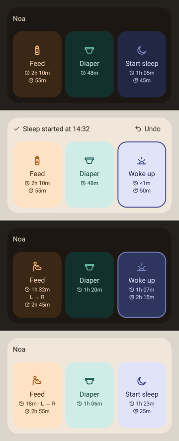 | 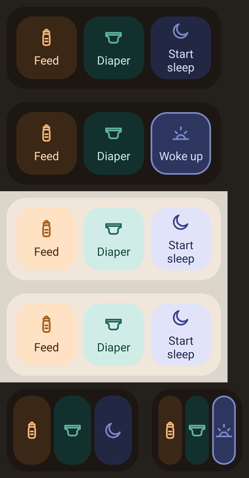 | 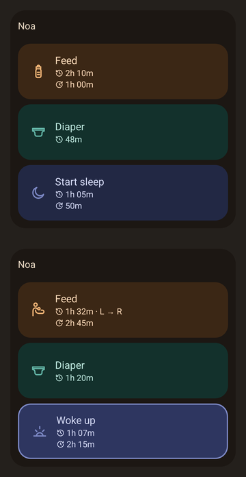 | 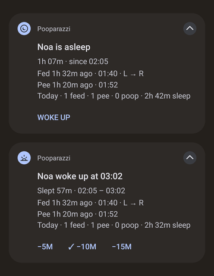 |

| Woken by a feed |
|:---:|
| 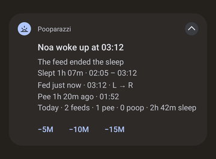 |

## Watch

Logs offline and syncs with the phone. A Tile, four complications and an Ongoing Activity show what comes next.

| Main | Asleep | Tile | Complications |
|:---:|:---:|:---:|:---:|
|  | 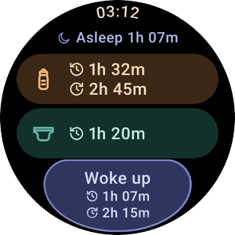 | 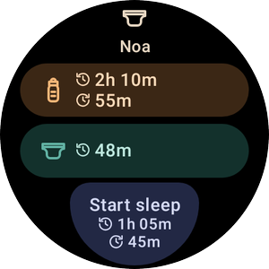 | 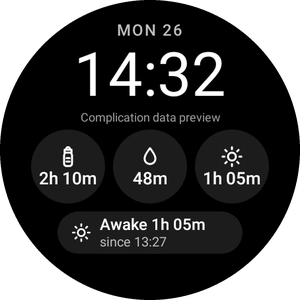 |

| Feed type | Side | Bottle | Bottle amount |
|:---:|:---:|:---:|:---:|
| 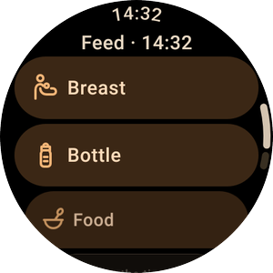 | 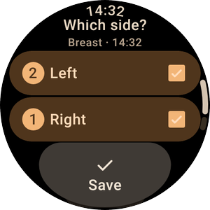 | 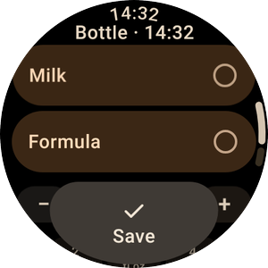 | 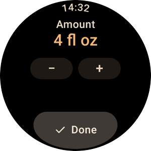 |

| Diaper | Colour | Texture | Logged + Undo |
|:---:|:---:|:---:|:---:|
| 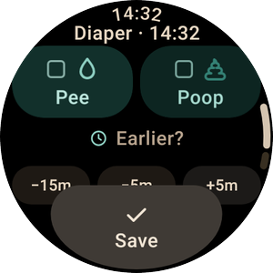 | 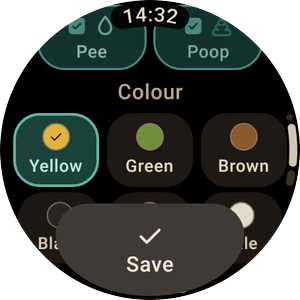 | 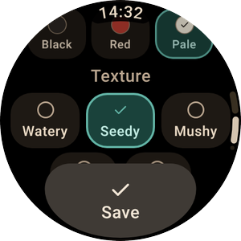 | 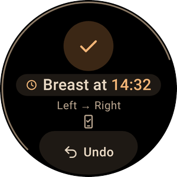 |

| Move the time | Woke up too | Logged bottle | Tile, asleep |
|:---:|:---:|:---:|:---:|
| 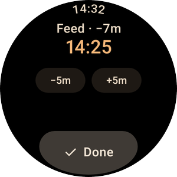 | 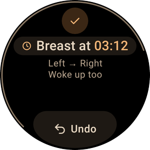 | 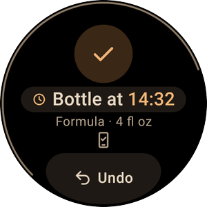 | 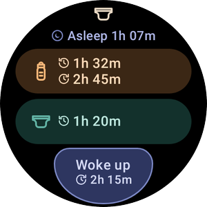 |

| After a breast feed | Large font | Small watch | Complications, asleep |
|:---:|:---:|:---:|:---:|
|  |  |  |  |

| Undone | Diaper while asleep | Sleep started | Move the sleep's start |
|:---:|:---:|:---:|:---:|
|  |  |  |  |

## Several babies

Twins or siblings: each baby has its own log, sleep and notification.

| Home, two babies | Switch baby | Babies | Widgets |
|:---:|:---:|:---:|:---:|
|  |  |  |  |

| Notifications | History | Add a baby | Birth date |
|:---:|:---:|:---:|:---:|
|  |  |  |  |

| Watch | Watch picker | Tile, second baby |
|:---:|:---:|:---:|
|  |  |  |

## Backup and families (optional)

No account needed. Sign in with Google or an email link to back up, and invite a partner or grandparent. Setup: [docs/BACKEND.md](docs/BACKEND.md).

| Welcome | Sign in | Check your email | Signed in |
|:---:|:---:|:---:|:---:|
|  |  |  |  |

| Consent | Family | Join a family | Sync status |
|:---:|:---:|:---:|:---:|
|  |  |  |  |

## Privacy

No ads, no analytics, no tracking. [Privacy policy](docs/PRIVACY.md) · [records of processing](docs/privacy).

| About | Delete account | Remove a member | Remove a baby |
|:---:|:---:|:---:|:---:|
|  |  |  |  |

## First run

| Your baby | Introduction | Sleep | Feeds and diapers |
|:---:|:---:|:---:|:---:|
|  |  |  |  |

| Fix anything | What comes next | Always at hand | Review prompt |
|:---:|:---:|:---:|:---:|
|  |  |  |  |

## Settings

Night and Day themes, English and Danish, and a watch install shortcut.

| Night theme | Settings | Install on the watch | No watch yet |
|:---:|:---:|:---:|:---:|
|  |  |  |  |

Made with ❤️ by a father in Aarhus, Denmark.

## Project structure

| Module | What it holds |
|---|---|
| [`core/`](core) | Android library shared by both apps: the `Entry` model and validation, the Room database and repository, the Data Layer sync (`sync/`), the backup sync engine (`cloud/`), settings and babies, summaries, statistics and the Lamp state (`domain/`), text formatting, the design tokens, type and icons, and the sample data used by previews and screenshots. |
| [`app/`](app) | The phone app (Compose, Material 3): Home, the Feed (with its Breast step) / Diaper sheets, History, Statistics, Edit, Settings, Welcome and Account (`account/`: Firebase Authentication and the Firestore backup), the Glance widgets (`widget/`) and the running-sleep notifications (`notify/`). |
| [`wear/`](wear) | The Wear OS app (Compose for Wear OS, Material 3): Main (which mirrors the Tile), Feed type, Side, Bottle, Diaper and Logged (with Time), plus the Tile (`tile/`), complications (`complication/`) and the Ongoing Activity (`ongoing/`). |
| [`docs/design/`](docs/design) | The design: [`DESIGN_SPEC.md`](docs/design/DESIGN_SPEC.md) (the Night and Day themes: screens, tokens, icons, accessibility) and [`V1_ADDITIONS.md`](docs/design/V1_ADDITIONS.md) (feed types, tick-ordered sides, optional diaper details, English + Danish) and [`BABIES_AND_BACKUP.md`](docs/design/BABIES_AND_BACKUP.md) (several babies, the optional account, backup and families); each later one wins where they differ. |
| [`firebase/`](firebase) | The backend: Firestore security rules, the retention job (`retention/`), their emulator tests, the Hosting website (`hosting/`: App Links file, invite and sign-in landing pages, privacy policy) and the deploy configuration ([docs/BACKEND.md](docs/BACKEND.md)). |
| [`scripts/`](scripts) | `readme_screenshots.py`, which builds the README images. |
| [`third_party/fonts/`](third_party/fonts) | Licences for the bundled fonts (Atkinson Hyperlegible Next and Google Sans Flex, both SIL OFL 1.1). |

## Build

Requirements: **JDK 21** (to run Gradle) and the **Android SDK with platform 37** (`compileSdk 37`; the apps target 36 and run on Android 11 / Wear OS 3 and later, `minSdk 30`). Point Gradle at the SDK with `ANDROID_HOME` or `sdk.dir` in `local.properties`.

```sh
export ANDROID_HOME=/path/to/android-sdk
./gradlew :app:assembleDebug :wear:assembleDebug
```

The APKs land in `app/build/outputs/apk/debug/app-debug.apk` and `wear/build/outputs/apk/debug/wear-debug.apk`.

Accounts and the backup need the Firebase project's `google-services.json` at `app/google-services.json` ([docs/BACKEND.md](docs/BACKEND.md#6-connect-the-app)). Keep it there locally (git ignores it); release builds get it from the `GOOGLE_SERVICES_JSON` repository secret. Without the file the phone app builds and runs as before, with accounts turned off.

## Install on devices

Both apps use the **same applicationId, `com.ffmathy.pooparazzi`**, and must be signed with the same key: the Wearable Data Layer only pairs a phone app and a watch app that match. Debug builds from one machine share its debug key; local release builds fall back to it too unless an upload key is configured (see [Releasing](docs/RELEASING.md)).

```sh
# Phone (USB or wireless debugging)
adb devices
adb -s <phone-serial> install -r app/build/outputs/apk/debug/app-debug.apk

# Watch: enable Developer options › ADB debugging (and Wireless debugging) on the watch, then
adb connect <watch-ip>:<port>        # or: adb pair <watch-ip>:<pair-port> first
adb -s <watch-ip>:<port> install -r wear/build/outputs/apk/debug/wear-debug.apk
```

Open the phone app once and set the baby's name in Settings › Babies (and add more babies there); the watch picks them up (and the language) over the Data Layer. Add the Tile from the watch's tile carousel and the complications from a watch face's edit screen.

## Tests

```sh
./gradlew :core:testDebugUnitTest :app:testDebugUnitTest :wear:testDebugUnitTest
```

Everything runs on the JVM with Robolectric (no emulator needed): view models, the repository and sync merge, formatting in both languages, TalkBack descriptions, navigation, widgets, the Tile layout and complications, and smoke tests of the apps' entry points. Statistics has plain JUnit tests of its rules in `core` (which days count, rounding, ranges, DST days and chart bins), plus view-model, TalkBack (English and Danish), navigation and screenshot tests in `app`.

The backend's Firestore security rules and the retention job have their own tests on the Firestore and Authentication emulators (Bun, Node.js 22 for the Firebase CLI, and JDK 21):

```sh
cd firebase && bun install && bun run test
```

Checks on the Android sources that no Gradle build catches (for example that both apps keep the Wear capabilities through release resource shrinking) are Bun tests in `tests/`:

```sh
bun test ./tests
```

## Screenshots

The screenshot tests (Roborazzi + Robolectric) render every screen in English and Danish into `app/screenshots/{en,da}/` and `wear/screenshots/{en,da}/`. They are rendered on the JVM, not taken from a device, so fonts and shadows can differ slightly from a real phone or watch.

```sh
# Re-record all screenshots
./gradlew :app:recordRoborazziDebug :wear:recordRoborazziDebug

# Rebuild the README images in docs/screenshots/ (needs Pillow: pip install Pillow)
python3 scripts/readme_screenshots.py
```

`readme_screenshots.py` takes a curated subset, scales phone shots to 360 px wide and masks watch shots to a 300 px circle. Edit its `PHONE` and `WATCH` maps to change the set.

On pull requests, the [`screenshots.yml`](.github/workflows/screenshots.yml) workflow does both on CI's Android SDK and pushes the result to the branch when anything changed, so the screenshots always show the UI being merged.

## Releasing

Every merge to `main` builds signed app bundles and APKs for the phone and the watch, attaches both APKs to a [GitHub Release](../../releases) for side-loading under a new version tag (a patch bump, or minor / major with the pull request's `release: minor` / `release: major` label), and uploads the bundles to Google Play (the production track by default) with the [`release.yml`](.github/workflows/release.yml) workflow; pull requests run the unit tests and a debug build ([`ci.yml`](.github/workflows/ci.yml)). The Google Play store images in `docs/play/` are rebuilt from the screenshots on every pull request and uploaded to the store listing when a merge changes them ([`store-listing.yml`](.github/workflows/store-listing.yml)). The secrets, the upload key, the Play service account and the one-time manual steps are in [docs/RELEASING.md](docs/RELEASING.md).

## Licences

The fonts bundled in the apps are licensed under the SIL Open Font License 1.1; their licence texts are in [`third_party/fonts/`](third_party/fonts) and are also shown in the phone app under Settings › Licences.
