# Pooparazzi

**Pooparazzi** is a baby tracker for an Android phone and a Wear OS watch, built for one-handed use at 3am. It logs **sleep**, **feeds** and **diapers** with one or two taps, keeps the phone and the watch in sync, and shows "how long since…" at a glance on the home screen, the lock screen, a watch tile and watch-face complications.

Only the time is ever required: the feed type, the breast side, pee/poop and the poop's colour and texture are optional extras.

<p align="center">
  
  &nbsp;&nbsp;
  
</p>

## Features

- **Sleep**: one button starts a sleep and the same button ("Woke up") ends it. The running sleep is shown as a ring with its length; the start can be adjusted while it runs.
- **Feeds**: Breast, Formula or Food, or **just the time**. Log it now or a few minutes ago (−5m / −10m / −15m).
- **Breast feeds with side order**: a breast feed is logged like any feed, at one time (no timer, no duration). After Breast, tick **Left** and/or **Right**: the order you tick is the order recorded ("Right → Left"). The side is optional; "Log feed" (watch: "Save") with nothing ticked records just the time. Wherever the last feed is shown (phone Home, the widget, the watch), its order is shown too ("Left → Right", or "L → R" where space is tight), so you know which side to start on next.
- **Diapers**: Pee and Poop are independent checkboxes, both optional (nothing ticked is a plain change). With Poop on, pick an optional **colour** (yellow, green, brown, black, red, pale) and **texture** (watery, seedy, mushy, formed, hard); red, black and pale show a gentle "talk to your doctor" hint.
- **History, edit and undo**: a day view with a 24-hour ribbon and day totals; tap any entry to edit its times, type, side or diaper details, or delete it; add a past entry; every log shows an **Undo** card (phone) or button (watch), with "Earlier?" chips to move it back.
- **Phone ↔ watch sync** over the Wearable **Data Layer**. Both apps log offline and merge by last-writer-wins; the baby's name and the language follow the phone.
- **Glanceable surfaces**:
  - Phone: two **Glance widgets** (a 4×2 log widget and a 3×1 quick widget, both with Feed, Diaper and Sleep; Feed and Diaper open the same sheets as in the app, the sleep toggle works in place), the 4×2 also on the **cover screen of Samsung flip phones**, and an **ongoing notification** for a running sleep (promoted to a Live Update where Android supports it).
  - Watch: a **Tile**, four **complications** (since last feed, last diaper, asleep/awake, sleep and last feed) and an **Ongoing Activity** while a sleep runs.
- **Night Light design**: a dim, warm Night theme for the dark hours and a Day theme, chosen automatically (or fixed in Settings). Large targets, TalkBack descriptions in full words ("2 hours 10 minutes ago"), large-font and small-watch layouts.
- **English and Danish**, with an in-app language choice (Settings › Language) that the widgets, notifications and the watch follow.

## Screenshots

All screenshots are rendered by the Roborazzi screenshot tests under Robolectric (see [Screenshots](#screenshots-1) below), not captured from a device, and use the sample day in `core/.../sample/SampleData.kt`.

### Phone

| Home, Night | Home, Day | Asleep at night | Breast feed logged |
|:---:|:---:|:---:|:---:|
|  |  |  |  |

| Undo card | Feed sheet | Breast: side order | Diaper sheet |
|:---:|:---:|:---:|:---:|
| 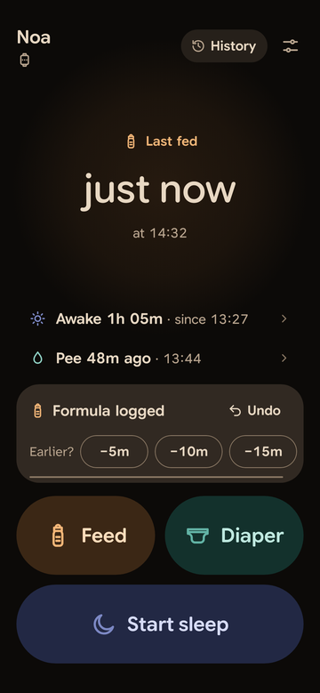 |  |  |  |

| History | History, Night | Edit feed | Edit diaper |
|:---:|:---:|:---:|:---:|
|  |  |  |  |

| Add past entry | Settings | Widget 4×2 | Widget 3×1 |
|:---:|:---:|:---:|:---:|
|  |  |  |  |

### Watch

| Main, idle | Main, asleep | Main, after a breast feed | Feed type |
|:---:|:---:|:---:|:---:|
|  |  |  |  |

| Side | Diaper | Poop colour | Logged + Undo |
|:---:|:---:|:---:|:---:|
|  |  |  |  |

| Undone | Today | Tile | Tile, asleep | Complications |
|:---:|:---:|:---:|:---:|:---:|
|  |  |  |  |  |

### På dansk (Danish)

| Hjem, nat | Hjem, dag | Amning | Ble | Historik | Indstillinger |
|:---:|:---:|:---:|:---:|:---:|:---:|
| 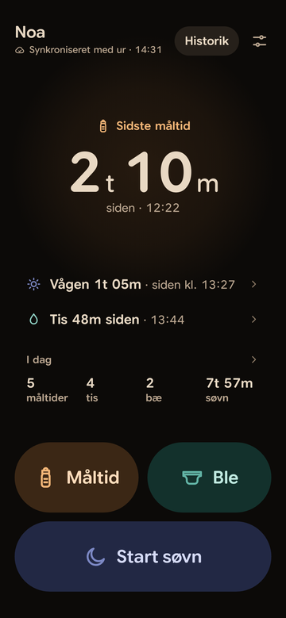 | 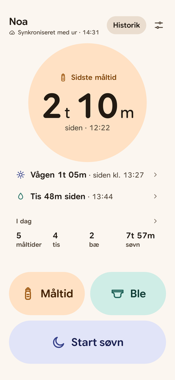 | 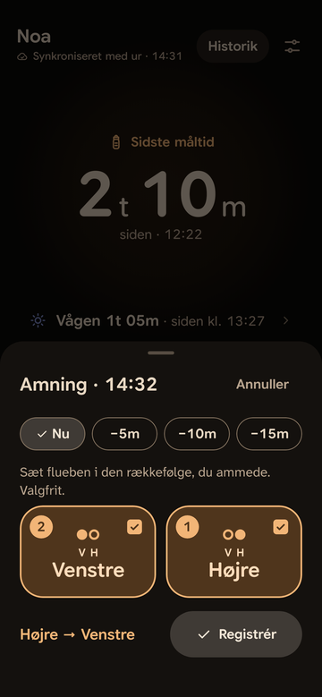 | 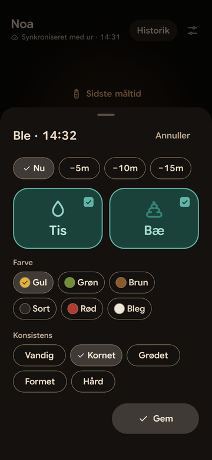 | 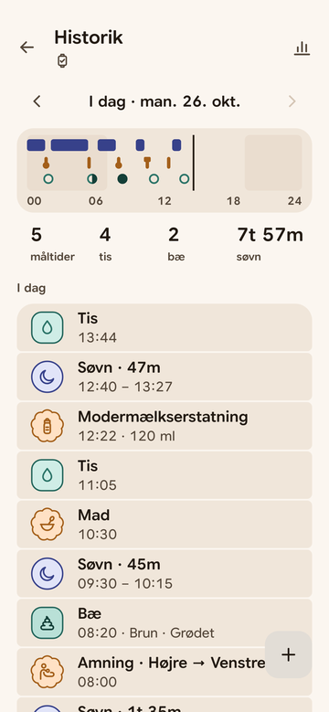 | 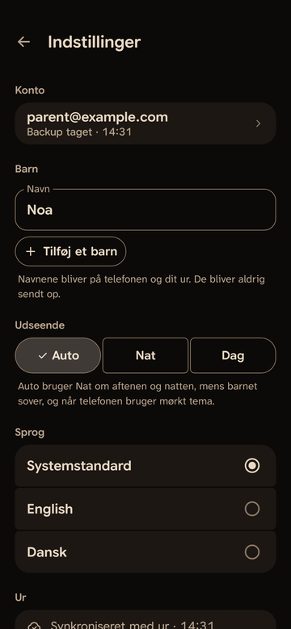 |

| Ur: hoved | Måltid | Hvilken side? | Ble | Registreret | Flise |
|:---:|:---:|:---:|:---:|:---:|:---:|
| 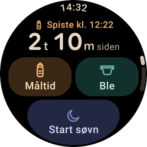 | 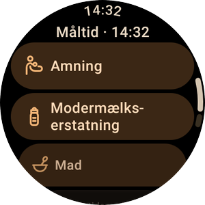 | 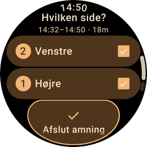 | 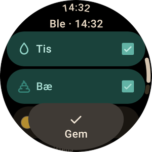 | 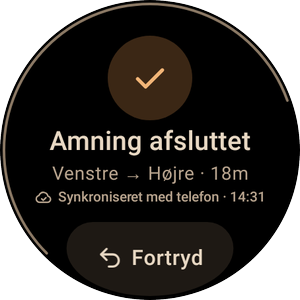 | 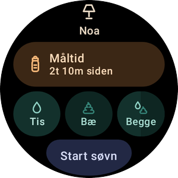 |

Every image above also exists in the other language: swap `en` and `da` in the path ([`docs/screenshots/`](docs/screenshots)).

## Project structure

| Module | What it holds |
|---|---|
| [`core/`](core) | Android library shared by both apps: the `Entry` model and validation, the Room database and repository, the Data Layer sync (`sync/`), settings, summaries and the Lamp state (`domain/`), text formatting, the design tokens, type and icons, and the sample data used by previews and screenshots. |
| [`app/`](app) | The phone app (Compose, Material 3): Home, the Feed (with its Breast step) / Diaper sheets, History, Edit, Settings, the Glance widgets (`widget/`) and the running-sleep notification (`notify/`). |
| [`wear/`](wear) | The Wear OS app (Compose for Wear OS, Material 3): Main, Feed type, Side, Diaper, Logged, Today and Adjust, plus the Tile (`tile/`), complications (`complication/`) and the Ongoing Activity (`ongoing/`). |
| [`docs/design/`](docs/design) | The design: [`DESIGN_SPEC.md`](docs/design/DESIGN_SPEC.md) (the "Night Light" direction: screens, tokens, icons, accessibility) and [`V1_ADDITIONS.md`](docs/design/V1_ADDITIONS.md) (feed types, tick-ordered sides, optional diaper details, English + Danish), which wins where they differ. |
| [`scripts/`](scripts) | `readme_screenshots.py`, which builds the README images. |
| [`third_party/fonts/`](third_party/fonts) | Licences for the bundled fonts (Atkinson Hyperlegible Next and Google Sans Flex, both SIL OFL 1.1). |

## Build

Requirements: **JDK 21** (to run Gradle) and the **Android SDK with platform 37** (`compileSdk 37`; the apps target 36 and run on Android 11 / Wear OS 3 and later, `minSdk 30`). Point Gradle at the SDK with `ANDROID_HOME` or `sdk.dir` in `local.properties`.

```sh
export ANDROID_HOME=/path/to/android-sdk
./gradlew :app:assembleDebug :wear:assembleDebug
```

The APKs land in `app/build/outputs/apk/debug/app-debug.apk` and `wear/build/outputs/apk/debug/wear-debug.apk`.

## Install on devices

Both apps use the **same applicationId, `com.ffmathy.pooparazzi`**, and must be signed with the same key: the Wearable Data Layer only pairs a phone app and a watch app that match. Debug builds from one machine share its debug key; local release builds fall back to it too unless an upload key is configured (see [Releasing](docs/RELEASING.md)).

```sh
# Phone (USB or wireless debugging)
adb devices
adb -s <phone-serial> install -r app/build/outputs/apk/debug/app-debug.apk

# Watch: enable Developer options › ADB debugging (and Wireless debugging) on the watch, then
adb connect <watch-ip>:<port>        # or: adb pair <watch-ip>:<pair-port> first
adb -s <watch-ip>:<port> install -r wear/build/outputs/apk/debug/wear-debug.apk
```

Open the phone app once and set the baby's name; the watch picks it up (and the language) over the Data Layer. Add the Tile from the watch's tile carousel and the complications from a watch face's edit screen.

## Tests

```sh
./gradlew :core:testDebugUnitTest :app:testDebugUnitTest :wear:testDebugUnitTest
```

Everything runs on the JVM with Robolectric (no emulator needed): view models, the repository and sync merge, formatting in both languages, TalkBack descriptions, navigation, widgets, the Tile layout and complications, and smoke tests of the apps' entry points.

## Screenshots

The screenshot tests (Roborazzi + Robolectric) render every screen in English and Danish into `app/screenshots/{en,da}/` and `wear/screenshots/{en,da}/`. They are rendered on the JVM, not taken from a device, so fonts and shadows can differ slightly from a real phone or watch.

```sh
# Re-record all screenshots
./gradlew :app:recordRoborazziDebug :wear:recordRoborazziDebug

# Rebuild the README images in docs/screenshots/ (needs Pillow: pip install Pillow)
python3 scripts/readme_screenshots.py
```

`readme_screenshots.py` takes a curated subset, scales phone shots to 360 px wide and masks watch shots to a 300 px circle with a transparent outside, for both languages. Edit the `PHONE` and `WATCH` lists in the script to change the set.

## Releasing

Every merge to `main` builds signed app bundles and APKs for the phone and the watch, attaches both APKs to a [GitHub Release](../../releases) for side-loading, and uploads the bundles to Google Play (the `internal` track by default) with the [`release.yml`](.github/workflows/release.yml) workflow; pull requests run the unit tests and a debug build ([`ci.yml`](.github/workflows/ci.yml)). The secrets, the upload key, the Play service account and the one-time manual steps are in [docs/RELEASING.md](docs/RELEASING.md).

## Licences

The fonts bundled in the apps are licensed under the SIL Open Font License 1.1; their licence texts are in [`third_party/fonts/`](third_party/fonts) and are also shown in the phone app under Settings › Licences.
